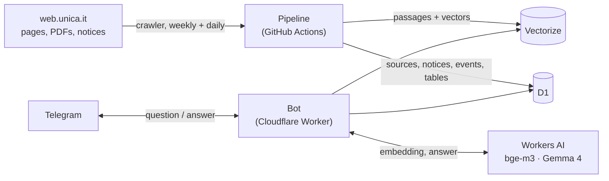

# UniRAG-inf

A Telegram bot that answers questions about the **Master's degree in Computer Science** of the
University of Cagliari (UniCa), using only the public pages and documents of the course and always
citing its sources.

> Unofficial project, not affiliated with the University of Cagliari.

>The repository contains the source code and architecture of the RAG system, allowing anyone to deploy their own instance. However, no publicly accessible instance of the authors' bot is provided.

This repository is the code of the project, published so that anyone can run their own copy. It is
shared **as is**: the authors run a private instance and do not offer support.

## How it works, in short

Once a week a crawler reads the course website, turns pages and PDFs into short passages and stores
them in a vector index; notices are checked every day. When someone asks the bot a question, it
finds the most relevant passages and a language model writes the answer from those alone, with a
link to each source.

Everything runs on free plans: GitHub Actions, Cloudflare (Workers, Workers AI, Vectorize, D1) and
Telegram. The full picture, with the main choices and how privacy is handled, is in
[How it works](docs/how-it-works.md).

## What the bot can do

Write a question in Italian or English, in full: "How many credits is Data Mining worth?", "When do
second semester lessons start?". Each message is independent; for a follow-up, use Telegram's
**Reply** on one of the bot's answers.

| Command | What it does |
| --- | --- |
| `/start` | What the bot is and how to ask |
| `/notices` (`/avvisi`) | The latest notices still valid |
| `/events` (`/eventi`) | The first seminars and activities that give credits, from the "Altre attività formative" page |
| `/updates` (`/novita`) | Pages and documents added or changed in the last 14 days |
| `/sources` (`/fonti`) | Where the information comes from and when it was last updated |

## What's in the repository

| Folder | What it contains |
| --- | --- |
| `pipeline/` | The weekly run: crawler, text extraction (tables of the PDFs included), passages, checks, writes to Vectorize and D1 (Python) |
| `bot/` | The Telegram bot, a Cloudflare Worker in TypeScript with no runtime dependencies |
| `rag_local/` | The same search-and-answer logic in Python, to ask questions from your computer |
| `core/` | Shared code: configuration, Cloudflare API, embeddings, academic calendar |
| `setup/` | One-off commands: Vectorize index, Telegram webhook and menu |
| `sql/` | Schema of the D1 database |
| `.github/workflows/` | The weekly and daily runs, and a secret scan (gitleaks) on each push |
| `docs/` | How it works, the crawler, the installation |

## Run your own copy

You need free accounts on GitHub, Cloudflare and Telegram, plus Python 3.14 with
[uv](https://docs.astral.sh/uv/) and Node.js on your computer. The whole procedure, from the accounts
to the first answer, is in [Installation](docs/installation.md). Before running the crawler, read
[Crawler](docs/crawler.md): it explains how it behaves towards the university website and what it
downloads.

## Documentation

- [How it works](docs/how-it-works.md): the pipeline, the answer to a question, the main choices, privacy.
- [Crawler](docs/crawler.md): what is downloaded and what is not, how the crawler behaves, how to stop it.
- [Installation](docs/installation.md): your own instance, step by step, and the local commands.

## Security and contributions

To report a security problem (a leaked secret, a flaw in the bot), please use GitHub's
**private vulnerability reporting** (*Security → Report a vulnerability*), not a public issue.

Issues about bugs in the code are welcome, but there is no support and no guarantee of an answer.
To change the project, fork it.

## Credits and license

Made by [@ChiccoSechi](https://github.com/ChiccoSechi), with [@AleFlu](https://github.com/AleFlu)
and [@Bacchiu](https://github.com/Bacchiu).

The **code** is released under the [MIT License](LICENSE). The **content** used by the bot (pages and
documents of the course) belongs to the University of Cagliari: it is not part of this repository
and is not covered by the license. The models are used through Cloudflare Workers AI: Gemma 4
(Apache 2.0) for the answers and bge-m3 (MIT) for the embeddings.
