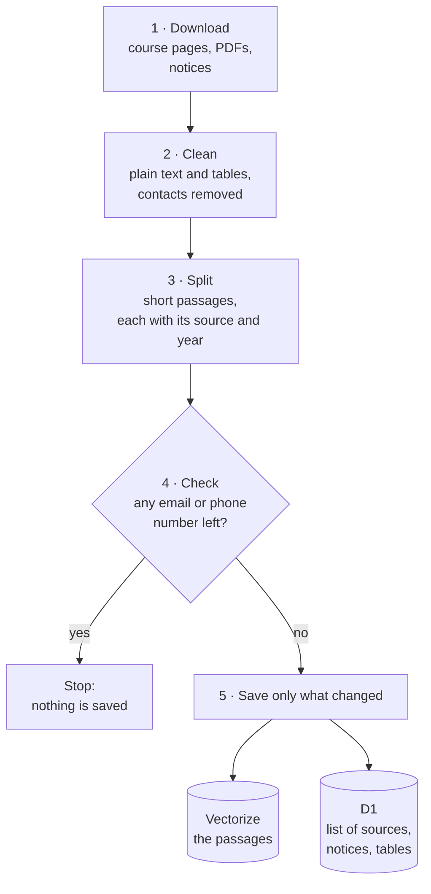
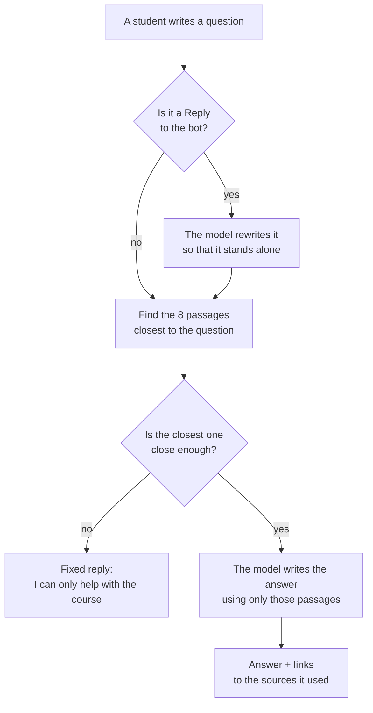
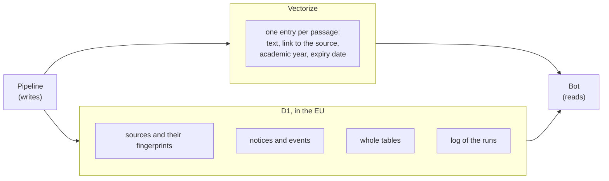

# How it works

UniRAG-inf is a **RAG** system (*retrieval-augmented generation*): before answering, it searches the
course content for the passages closest to the question, and a language model writes the answer
using only those passages, citing them. It has two halves that never talk to each other directly:
the **pipeline**, which keeps the content up to date, and the **bot**, which answers. They meet in two
Cloudflare services: **Vectorize** (the passages and their vectors) and **D1** (everything else).

## The pipeline: from the website to the index

Every Sunday night a GitHub Actions workflow reads the whole course website again. From Monday to
Saturday a short morning run looks only for new notices (usually 1–3 requests).

1. **Download** (`pipeline/crawl.py`). It follows the menu of the course pages, the PDFs linked from
   them, the latest notices with their attachments and the course descriptions of the official
   catalogue. One request per second, always declaring who it is: see [Crawler](crawler.md).
2. **Clean** (`pipeline/extract.py`). Web pages become plain text without menus. PDFs are read
   with `pdfplumber`; their tables (study plans, exam calendar, timetable, elective exams) are read by
   dedicated code that uses the position of each cell, without any language model, and checks that
   no value of the table got lost. In the timetable, the colour of a cell tells the room. Emails,
   phone numbers and students' names are removed here.
3. **Split** (`pipeline/chunk.py`). The text is split where it is already split (headings,
   articles) into passages of at most about 1,500 characters, each starting with its context
   ("Teaching › Exams › …"). Tables become one sentence per row, plus the whole table kept in D1.
   Short summary sentences are added for "list" questions ("which courses are taught in English?").
   The regulations of the two cohorts currently enrolled are almost identical: an identical article
   is stored once, in the newer document, with a link to the older one (`pipeline/cohorts.py`).
4. **Check** (`pipeline/checks.py`). Before writing, the run looks at the real data once more: an
   email address or a phone number left in a passage stops it; a source that lost most of its
   content since last week only raises a warning.
5. **Save** (`pipeline/run.py`). Each source has a fingerprint: only new or changed sources get new
   vectors (model `bge-m3`). **Vectorize is always written first, then D1**, which is the record of
   what Vectorize contains: if a run stops halfway, the next one sees the difference and fixes it.
   A page that disappears is marked, and deleted only if it is still missing at the next full run
   (two full runs in a row, normally a week; the daily notices runs do not count). If the website is
   down or too many pages are missing at once, nothing is written.

## The bot: answering a question

The bot is a Cloudflare Worker written in TypeScript (`bot/`). It answers Telegram at once and does
the work in the background, so Telegram never sends the same message twice.

Course codes written in the question, like "RAL" or "nlp", get the course name after them before
the search ("RAL (Reinforcement and Adversarial Learning)"): a code alone means nothing to the
embedding. The codes come from the legend of the lesson timetables (codes of two letters only when
written in capitals, since "no" or "ds" are words).

Behind the scenes: the question becomes a vector with `bge-m3` (Workers AI), the passages are
searched in Vectorize among those of the two cohorts that have not expired, whole tables and source
titles come from D1, and the answer is written by Gemma 4 (Workers AI). "Close enough" means a
similarity score of at least 0.40: below it the question is off topic and costs no model call.

The model gets strict rules: use only the passages, say clearly when the answer is not there, never
invent, state the academic year when it matters, answer in the language of the question, refuse
requests unrelated to the university. The bot then keeps only the sources the answer really cites.

The fixed texts of the bot (`/start`, commands, errors) are in Italian or English, following the
language of the Telegram app or the name of the command (`/avvisi` Italian, `/notices` English). If the
daily Workers AI quota is over, the bot says so and the commands still work; if the model is
overloaded, it tries once more and then asks to retry in a few seconds.

The commands `/notices`, `/events`, `/updates` and `/sources` read D1 directly, without the language
model. `/events` lists the seminars and activities of the "Altre attività formative" page in the
page's order, with date and credits as written there: the pipeline stores them in D1 when it reads
that page.

## The data

### Source codes

Every source has a short code, always the same for the same address: `p21` (course page
`crs_60_73_21`), `p14.2` (page 2 of a list), `d541442` (PDF), `i23489.2026` (course description of
subject 23489, 2026 offer), `a…` (notice), `e…` (external page). The passages of a source are
`<code>-0`, `<code>-1`…, so they can be found and deleted by ID.

### Vectorize: the passages

One entry per passage: its vector (1,024 numbers from `bge-m3`) and these metadata, always all
present (an entry without a field would escape the filters):

| Metadata | What it holds |
| --- | --- |
| `text` | The passage, starting with its context ("Teaching › Exams › …") |
| `url` | Link to the original page or PDF |
| `page` | Code of the source (`p21`); used in filters instead of the URL |
| `kind` | `page`, `external`, `notice`, `course` or `pdf` |
| `year` | Academic year (`2026/2027`) or `all` |
| `valid_until` | Expiry as a Unix timestamp: notices (and their attachments) expire 7 days after the latest date in their text, or on 31 December if they have none; everything else never (31/12/9999) |
| `table` | ID of the whole table in D1 if the passage is a row of a table, otherwise empty |

The bot searches with a filter: the two running cohorts (or `all`) and not expired. The metadata
indexes on `year`, `kind`, `valid_until` and `page` must exist before the first passage is written.

### D1: everything else

The database is in the EU jurisdiction (`sql/schema.sql`). Only the pipeline writes; the bot reads.
There is no table about users. Dates are Unix timestamps.

| Table | One row per | Main columns | Read by |
| --- | --- | --- | --- |
| `sources` | source in Vectorize | `code`, `url`, `title`, `kind`, `year`, `hash` (fingerprint of its passages), `text_hash` (fingerprint of the extracted text), `chunk_count`, `absent_since`, `added_at`, `changed_at` | pipeline (what to rewrite or delete), bot (titles of the sources, `/sources`, `/updates`) |
| `notices` | notice | `title`, `url`, `published_at`, `deadline`, `valid_until` | bot (`/notices`) |
| `events` | event of the "Altre attività formative" page | `position` on the page, `title`, `date_text` and `credits` as written on the site, `url` | bot (`/events`) |
| `tables` | table of a PDF | `context` (study path, year of the course), `year`, `markdown` (the whole table) | bot (passed to the model instead of a single row) |
| `copies` | passage shared by the regulations of the two cohorts | `chunk`, `source` (newer document), `also_for` (older one) | bot (both years and both sources in the answer) |
| `acronyms` | course code of a lesson timetable | `source` (the timetable), `code`, `name` (without teachers) | bot (course name added after a code in the question) |
| `runs` | pipeline run | new, changed, absent and deleted sources; passages written and deleted; `neurons`; `outcome` (`ok`, `ok_notices`, `error`); `error` (only its type); `extraction_version` | pipeline, `/sources` (date of the last full run) |

### How they stay in sync

Vectorize and D1 are not linked: the link is the source code, the same in both. Vectorize can only
search and delete by ID, so **D1 is the record of what Vectorize contains** and is always written
**last**: if a run stops after Vectorize, D1 still has the old fingerprint, the next run sees the
source as changed and writes it again.

- `hash` decides what to rewrite: same fingerprint, nothing to do.
- `text_hash` tells why: if it changed, UniCa changed the page (it shows in `/updates`); if not, our
  code changed (for example new splitting rules), and `/updates` ignores it.
- `absent_since` is set the first time a source is missing; at the next full run, if it is still
  missing, its passages and its row are deleted. The bot never shows passages of absent sources. A
  PDF that no longer exists (its address answers with the portal's login or 404) is deleted at once,
  so an old and a new version of the same document are never both cited.

Names in the code and in the database are in English; the content (texts of the passages, answers)
is in Italian, like the course website.

## Main choices

| Choice | Why |
| --- | --- |
| Cloudflare free plan for everything the bot uses | No credit card, no training on the data, one place for model, index and database |
| Language model **Gemma 4 26B** | Among the models available on Workers AI, the best at what the bot needs: it answers in the language of the question (Italian or English), says clearly when the answer is not in the passages instead of inventing it, refuses requests unrelated to the course and does not accept false premises. Answers come in a few seconds, with a reasonable use of the free quota |
| Embeddings **bge-m3** | Among the multilingual embedding models on Workers AI, the one that finds the right passages most often on the course texts, in Italian and English, tables included; also the fastest |
| No reranker | The only one available (`bge-reranker-base`) is trained mainly on English and Chinese and does not help with Italian texts |
| Bot in **TypeScript** | The free plan allows 10 ms of CPU per request: TypeScript stays well within it, Python on Workers does not |
| Tables read by code, not by a model | Vision models misplace cells (for example lessons on the wrong day); the position of each cell in the PDF is exact and can be checked |
| Both cohorts searched at once | The bot does not ask the year of enrolment: when the rules differ, the answer gives both, each with its year |
| Off-topic filter | If even the closest passage is far from the question (similarity below 0.40), the bot answers with a fixed text without calling the model: obvious off-topic questions cost nothing, questions about the course pass |

## Privacy by design

- The bot **stores nothing** about who writes to it: no messages, answers, names, Telegram IDs,
  counters or history. The question stays in memory only for the few seconds needed to answer.
- **Logs are off**: Workers Logs disabled in the configuration; Traces and Logpush must stay off in
  the dashboard too. On an error the code records only its type (for example `TypeError`), never the
  question, the answer, the chat or the token. The only place that writes to the logs is
  `logEvent()` in `bot/src/bot.ts`: the authors' tests check that a recognisable word sent to the
  bot never appears in any output.
- The question passes through **Telegram** (which delivers it) and **Cloudflare**, which runs the bot,
  the models and the index. The language model and the embedding model are hosted by Cloudflare on
  Workers AI, and Cloudflare states that it "does not use your Customer Content to train any AI
  models made available on Workers AI" ([Workers AI data usage](https://developers.cloudflare.com/workers-ai/platform/privacy/)).
- Only **public** course content is indexed. Of professors only name and role are kept; emails,
  phone numbers and students' names are removed, and the run stops if any of them slips through.
- The bot **answers anyone** who writes to it in a private chat: there is no list of allowed users,
  because it would mean storing their IDs.

If you open your own instance to other people, you become the data controller: you will need your
own privacy notice.

## Credits and licenses

- Code of this project: [MIT](../LICENSE).
- **Gemma 4** by Google, [Apache License 2.0](https://ai.google.dev/gemma/docs/gemma_4_license), and
  **bge-m3** by BAAI, [MIT](https://huggingface.co/BAAI/bge-m3), both used through Cloudflare Workers AI.
- Python libraries: beautifulsoup4 (MIT), httpx (BSD-3-Clause), markdownify (MIT), pdfplumber (MIT),
  protego (BSD-3-Clause), python-dotenv (BSD-3-Clause), PyYAML (MIT).
- Bot tools, for development only: wrangler (MIT or Apache 2.0) and TypeScript (Apache 2.0).
- Content: University of Cagliari, not included in the repository (see [Crawler](crawler.md)).
